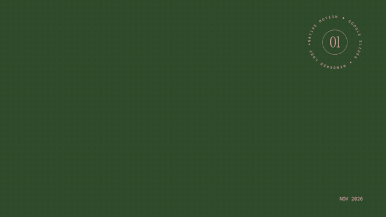

# claude-google-slides

Make eye-catching, motion-rich Google Slides decks programmatically with Claude.

## Gallery

[Motion gallery](gallery/README.md): six example prompts, each with a motion preview and the resulting native Google Slides deck.

## Research

- [Google Slides + Motion: Discovery Report](docs/research/2026-11-17-google-slides-motion-discovery.md)
- [Style Direction](docs/research/style-direction.md)
- [GIF Budget for Motion Decks](docs/research/gif-compression.md)
