# Google Slides + Motion: Discovery Report

Date: 2026-11-17. Scope: discovery only. No build.

## TL;DR

- The Slides API builds layout, text, images, video and charts. It **cannot** set animations or transitions. Apps Script cannot either.
- PPTX import **does** carry native animations into Slides. I tested it. Fade, Fly in, Zoom, Spin and four transitions survived. Morph and motion paths died.
- Real motion comes from rendered assets: **animated GIF loops** and **Drive MP4s**. A JS motion skill (HyperFrames or Remotion) can render both.
- Nobody ships a strong design layer for native Google Slides. The best-looking AI decks are HTML or PPTX. That gap is our opening.
- Recommendation: **native-first hybrid**. Slides API for structure. Rendered loops for motion. Template or PPTX bridge for native builds.

---

## 1. Capability map

### 1.1 Native Slides (UI)

| Area | What exists |
|---|---|
| Object animations (15) | Appear, Disappear, Fade in/out, Fly in/out (left, right, top, bottom), Zoom in/out, Spin |
| Animation triggers | On click, With previous, After previous. Speed slider. "By paragraph" for text |
| Transitions (7) | Dissolve, Fade, Slide from right, Slide from left, Flip, Cube, Gallery. One speed slider |
| Missing vs PowerPoint | Morph, motion paths, emphasis (except Spin), wipe, delays, triggers |
| Video | YouTube or Drive. Play on click / automatically / manually. Start, end, mute. Loop: sources conflict, treat as unreliable |
| Images | PNG, JPEG, GIF. Animated GIFs keep all frames (verified in export). Crop, mask, recolor, transparency, drop shadow |
| Charts | Linked from Google Sheets. Render as static images. No chart animation |
| Fonts | Full Google Fonts library. No custom font upload |
| Effects | Solid and gradient fill, drop shadow, reflection. No glow, soft edge, 3D, bevel |
| Page size | Default 16:9 at 10 × 5.625 in. PowerPoint uses 13.333 × 7.5 in |

### 1.2 Slides API (`presentations.batchUpdate`)

| Capability | Status |
|---|---|
| Create slides from layouts, duplicate slides/objects | ✅ |
| Shapes (~170 types), lines, connectors, arrows | ✅ |
| Tables (merge, borders, cell fill) | ✅ |
| Text: any Google Font, size, color, links, bullets, spacing | ✅ |
| Images (`createImage`, `replaceImage`, `replaceAllShapesWithImage`) | ✅ PNG/JPEG/GIF. <50 MB, ≤25 MP. **URL must be public** |
| Video (`createVideo`) | ✅ YouTube or Drive. `autoPlay`, `start`, `end`, `mute`. No loop field |
| Sheets charts | ✅ `LINKED` (refreshable) or `NOT_LINKED_IMAGE` |
| Page background | ✅ Solid color or stretched picture |
| Theme color scheme | ✅ On master pages only |
| Shape fill | ⚠️ Solid only. No gradient write |
| Shadow, image brightness/contrast/transparency/recolor | ⚠️ Read-only |
| Text autofit | ⚠️ Only `NONE` is writable |
| **Animations** | ❌ No field, no request |
| **Transitions** | ❌ No field, no request |
| Create layouts, masters, themes | ❌ Start from a template deck instead (Drive copy) |
| Glow, soft edge, 3D | ❌ |

Apps Script `SlidesApp`: same gaps. No animation or transition methods. Video playback settings are not exposed.

Implication: gradients, shadows and animations must come from a **template** or a **PPTX import**. The API then fills content.

### 1.3 PPTX → Google Slides import (tested)

Method: I generated a probe `.pptx` with one feature per slide. I uploaded it to Drive with conversion. I exported it back to `.pptx` and PDF and diffed the XML. Script: [`probes/pptx_import_probe.py`](probes/pptx_import_probe.py). Probe deck in Drive: "[claude-google-slides] pptx import fidelity probe".

| Input | Result in Slides |
|---|---|
| Fade transition | ✅ Kept |
| Dissolve transition | ⚠️ Mapped to a fade variant (exports as fade-through-black) |
| Push transition | ✅ Kept as slide transition. Direction changed (up → left) |
| Flip transition (p14) | ✅ Kept. Direction flipped |
| Gallery transition (p14) | ✅ Kept |
| Morph transition | ❌ Dropped. No fallback |
| Fade in (on click) | ✅ Kept |
| Fly in from left | ✅ Kept |
| Zoom entrance | ✅ Kept, remapped to Slides "Zoom in" |
| Spin emphasis | ✅ Kept. Direction reversed |
| Wipe entrance | ⚠️ Remapped to Fade in |
| Motion path | ❌ Dropped |
| Gradient fill | ✅ Kept |
| Custom outer shadow | ✅ Kept |
| Glow, soft edges | ❌ Dropped |
| Google Fonts (Playfair Display, Space Grotesk) | ✅ Rendered |
| Animated GIF | ✅ Kept, all 24 frames |
| Native PowerPoint chart | ⚠️ Flattened to a static PNG |
| python-pptx default shapes | ⚠️ Gain a subtle theme drop shadow. Strip it in generation |

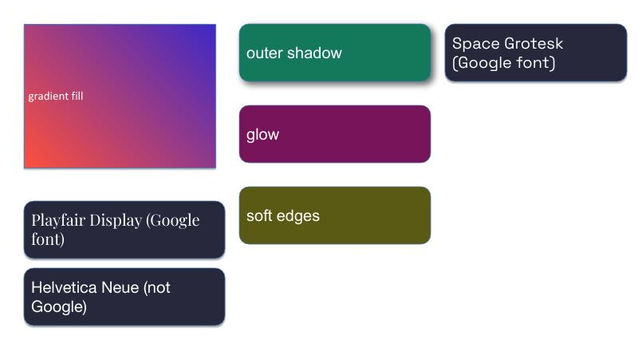

Secondary sources add: non-Google fonts may fall back to Arial. SmartArt arrives as groups. Embedded video and audio do not survive. Only title, subtitle, body and image placeholders map cleanly. [BrightCarbon], [Nuts & Bolts].

Not verified yet (needs a signed-in browser or API credentials): GIF playback in present mode, Drive MP4 autoplay and loop, and whether `duplicateObject` keeps animations.

---

## 2. Prior art

### 2.1 Google Slides generators (native)

| Tool | Approach | Motion | Verdict |
|---|---|---|---|
| [googleworkspace/md2googleslides] | Markdown → Slides API | None | Google's own sample. Plain, dated. Baseline only |
| [motchii709/slidesmith] | Deck JSON → batchUpdate, theme baked in code | None | Right idea (deterministic, no AI slop). Basic look |
| [matteoantoci/google-slides-mcp], [taylorwilsdon/google_workspace_mcp] (3.5k★) | MCP plumbing for the API | None | Pipes, no design layer |
| Composio / Inkeep Slides skills | Hosted MCP + brand tokens | None | Pipes, no design layer |
| Claude Slides (Anthropic) | Artifact → "Export to Google Slides" via Drive, or PPTX | Transitions dropped in PPTX | Charts and shapes become pictures in PPTX |
| Claude Design (Anthropic Labs, Apr 2026) | Canvas → PDF / PPTX / HTML / Canva | Not in export | No direct Google Slides export. Users report font and line-break damage in PPTX |

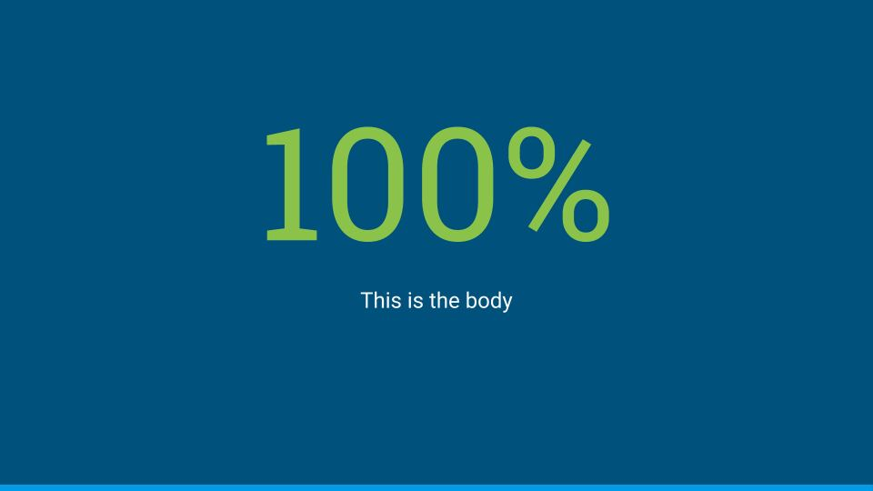
*md2googleslides. Clean but generic. This is the default "programmatic Slides" look to beat.*

### 2.2 Best-looking static decks (HTML or PPTX, not native Slides)

These set the design bar. None target Google Slides.

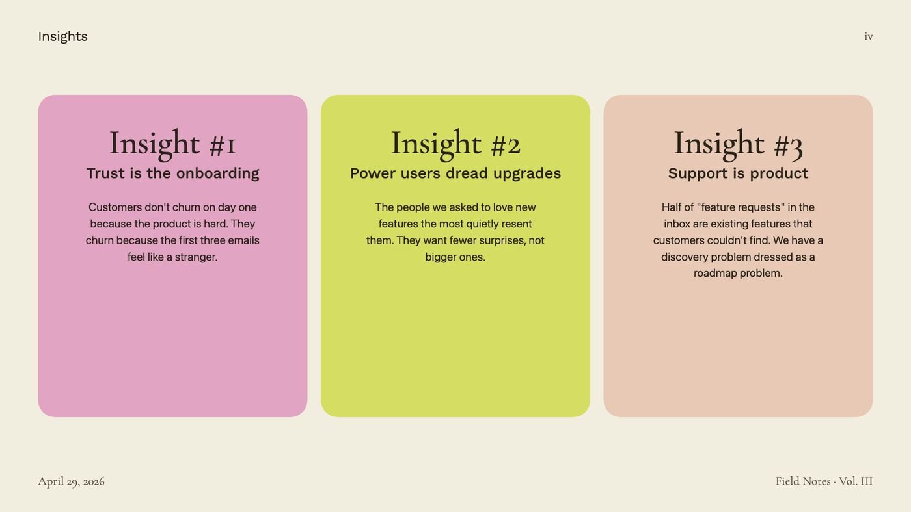
*[zarazhangrui/beautiful-html-templates] (used by frontend-slides, 32k★). Editorial serif + grotesk. Restrained palette. Feels designed. Strong reference.*

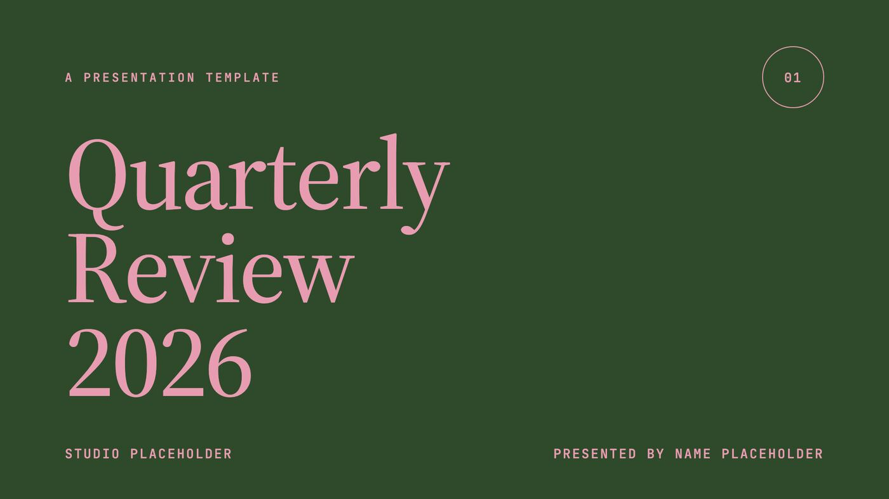
*Same library. Big serif, two colors, mono labels. Translates well to native Slides.*

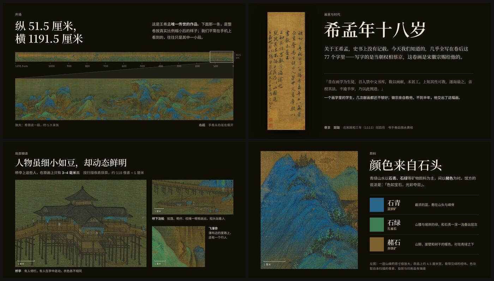
*[alchaincyf/huashu-design] (30k★). Museum-grade editorial. Real images, scale bars, tight hierarchy. Best static craft found.*

*[addsumtech/slides_maker]. Native editable PPTX. Warm photo-led layouts. Good. Generated photos read slightly stock.*

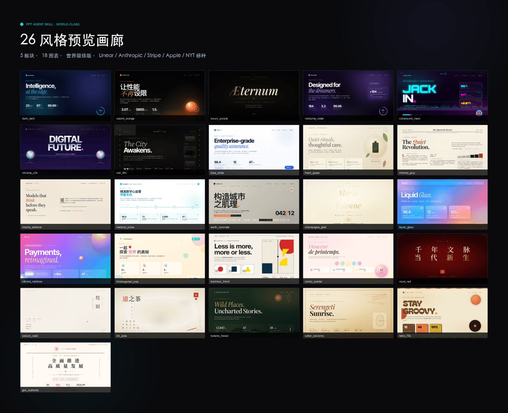
*[Akxan/ppt-agent-skill]. 26 styles. Polished but template-y. Several hit slop tells: glowing orbs, neon, glassmorphism, purple gradients. Mixed.*

*[chuspeeism/dashi-ppt-skill] (10k★). Clean infographics. Generic SaaS pastel look. Mid.*

### 2.3 Claude motion skills (JS → video)

"The Claude motion skill" is not one thing. The main options:

| Skill | Stack | Output | Notes |
|---|---|---|---|
| [heygen-com/hyperframes] (85k★) | HTML + CSS + GSAP / Lottie / Three.js | MP4, **WebM/MOV with alpha**, **GIF (looping)**, PNG sequence | Deterministic, headless Chrome + FFmpeg. Has a `/slideshow` skill (HTML deck, not Slides). Most popular |
| [remotion-dev/skills] | React (Remotion) | MP4 | The January 2026 viral one |
| [feitangyuan/onetake] | HTML, one continuous camera | MP4 | Best motion craft found. Non-commercial license |
| [Tejashmakwana/motionmaxxing] | HTML + measured eases + lint gates | MP4 | Explicit anti-slop rubric. Worth adopting |
| [bangtutorial/bang-motion] | Browser motion graphics | MP4 | Bold kinetic type styles |
| [iart-ai/motion-skills], [charlie947/motion-graphics-skills] | Remotion / HTML | MP4/GIF | Generic. See below |

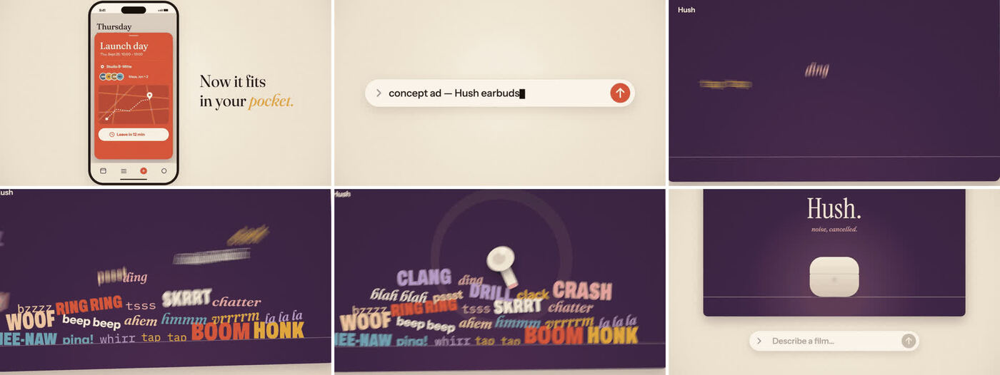
*onetake. Every beat grows from the last. Real UI, real motion blur, warm palette. This is the "wow" bar.*

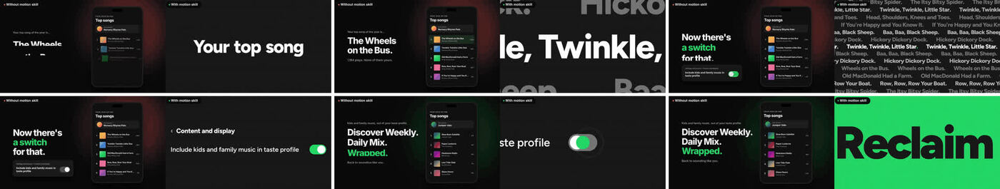
*motionmaxxing. Left of each pair: default AI motion ("a slide deck that moves"). Right: with the skill. Full-bleed type, one idea per beat.*

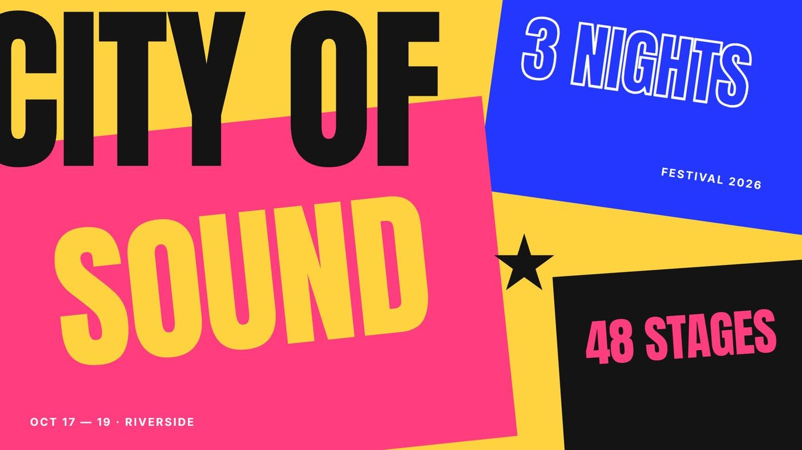
*bang-motion. Poster energy. Rotated color blocks, condensed caps. Good for openers.*

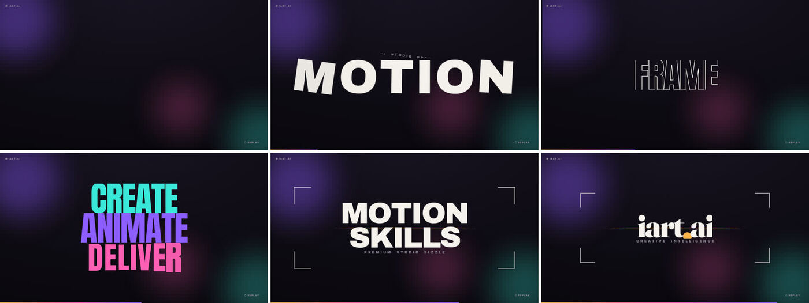
*iart-ai. Blurred gradient orbs, corner brackets, stacked caps. Competent but generic sizzle. Mid.*

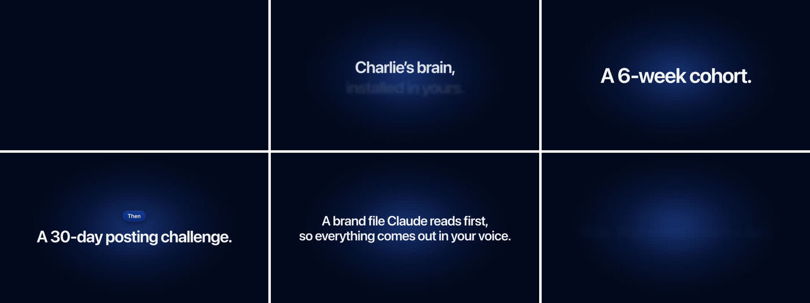
*charlie947. Centered white text, blue glow on navy, blur-in. The classic AI-slop look. Avoid.*

### 2.4 Closest to our goal: native deck + motion

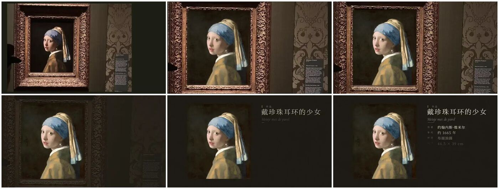
*[Cennyk-learner/ppt-cinematic-animation]. Real PowerPoint playback. Looping GIF backgrounds (computed frame by frame) + native animations + editable text. No embedded video. Cinematic and tasteful.*

This proves the middle ground works. It is PowerPoint-only (Windows COM, Morph, motion paths). Its key gotcha applies to Slides too: **a GIF starts playing when the slide opens, not when it appears.**

### 2.5 Anti-slop rules worth stealing

From motionmaxxing, frontend-slides and ppt-cinematic-animation:

- No page chrome: corner labels, "02 / 05" counters, corner brackets, progress bars.
- No "headline left, card right" on every slide.
- No glow, lens flare, purple gradients, glassmorphism, bouncy easing.
- No fade on everything. Prefer transform moves and cuts on motion.
- One idea per slide. Type can be the picture.
- Fonts come from the subject, not the default.
- Check rendered frames on a contact sheet before shipping.

---

## 3. Motion options inside native Slides

| # | Option | Motion quality | Native / editable | Effort | Gotchas |
|---|---|---|---|---|---|
| M1 | Native animations + transitions | Low (15 presets) | ✅ Fully | API can't set. Needs M4 or M5 | Fade/Fly/Zoom only. No easing control |
| M2 | Animated GIF loops (rendered by HyperFrames/Remotion) | High motion, limited color | ✅ Image object | Medium | 256 colors, 1-bit alpha, banding on gradients. 50 MB / 25 MP. Likely starts at slide open, not on its build (true in PowerPoint) |
| M3 | Drive MP4 via `createVideo` | Highest (full color, 60 fps, audio) | ✅ Video object | Medium | No alpha. Player chrome on hover. Viewers need Drive access. Loop unreliable. Autoplay only in present mode |
| M4 | PPTX bridge (python-pptx + OOXML animation XML → Drive import) | Low–medium | ✅ After import | Low | Proven above. Morph/paths lost. Page resize to 10 in. Strip default shadows |
| M5 | Template deck with pre-built animations, filled by API | Low–medium | ✅ | Low once built | Unverified: does `duplicateObject` keep animations? Test first |
| M6 | Claude in Chrome sets animations in the UI | Low–medium | ✅ | High, brittle | Polish pass only |

Design tactics that hide Slides' limits:

- Use flat or limited palettes in GIFs. Avoid soft gradients. They band.
- Render GIF loops on the exact slide background color. 1-bit alpha then looks clean.
- Put full-bleed hero motion in MP4. Overlay native text on top for editability.
- Fake "magic move" with two near-identical slides and a Dissolve transition.
- Use Sheets-linked charts for data. Animate the reveal with native Fade/Fly per series group.

---

## 4. Recommendation

### Option A: Native-first hybrid (recommended)

- **Structure:** Slides API `batchUpdate` into a hand-built template deck (masters, Google Fonts, color scheme).
- **Motion:** HyperFrames (HTML/GSAP) renders loops. GIF for accents and backgrounds. MP4 on Drive for hero moments.
- **Builds:** Native Fade/Fly/Zoom from template slides (M5), with the PPTX bridge (M4) as fallback.
- **Taste:** Anti-slop rules + a reference library from your past decks.
- Trade-offs: fully native and live-editable. Two pipelines (deck + renderer). Motion is loops plus simple builds, not choreography.

### Option B: PPTX-first, import once

- Generate the whole deck as `.pptx` with OOXML animations and GIFs. Convert in Drive.
- Trade-offs: one pipeline, native builds in one shot. Less control after import. Layout rescale. Charts become images. Every change means a re-import.

**Decision (2026-11-17): A, native-first hybrid, chosen by the project owner.**

**Recommendation: A.** It keeps decks editable through the API and gets the "wow" from rendered motion. PPTX stays a tool for injecting animations, not the main format.

### Next experiments (before building)

1. Confirm GIF playback and Drive MP4 autoplay/loop in present mode.
2. Confirm `duplicateObject` keeps animations on template slides.
3. Render one HyperFrames loop to GIF at 1280×720. Check banding and file size.
4. Collect 3–5 of your past "wow" decks as the style reference.
5. Set up a Google Cloud project with Slides + Drive OAuth scopes.

---

## Sources

- Slides API reference: [pages](https://developers.google.com/workspace/slides/api/reference/rest/v1/presentations.pages), [requests](https://developers.google.com/workspace/slides/api/reference/rest/v1/presentations/request), [videos](https://developers.google.com/workspace/slides/api/reference/rest/v1/presentations.pages/videos), [add image](https://developers.google.com/workspace/slides/api/guides/add-image), [add chart](https://developers.google.com/workspace/slides/api/guides/add-chart)
- Apps Script: [SlidesApp](https://developers.google.com/apps-script/reference/slides/slides-app), [Video](https://developers.google.com/apps-script/reference/slides/video)
- Google help: [animations and transitions](https://support.google.com/docs/answer/1689475), [video playback option (2020)](https://workspaceupdates.googleblog.com/2020/10/new-video-playback-option-google-slides.html)
- Animation and transition names: [HelpDeskGeek](https://helpdeskgeek.com/how-to-add-animation-to-google-slides/), [SlidesAI](https://www.slidesai.io/blog/add-transitions-google-slides)
- PPTX conversion: [BrightCarbon], [Nuts & Bolts]
- Claude Design / Claude Slides: [Unite.AI](https://www.unite.ai/anthropic-launches-claude-design-for-visual-prototyping-and-presentations/), [Deckary](https://deckary.com/blog/claude-slides), [Hora de Codar](https://horadecodar.com.br/claude-design-powerpoint/)
- Motion skills overview: [AutoAE comparison](https://autoae.online/blog/claude-motion-graphics-skills), [awesomeclaude](https://awesomeclaude.ai/claude-motion-graphics)
- Images © their authors, from public GitHub READMEs, used here for reference.

[BrightCarbon]: https://www.brightcarbon.com/blog/convert-powerpoint-google-slides/
[Nuts & Bolts]: https://nutsandboltsspeedtraining.com/tutorials/powerpoint-vs-google-slides-compatibility
[googleworkspace/md2googleslides]: https://github.com/googleworkspace/md2googleslides
[motchii709/slidesmith]: https://github.com/motchii709/slidesmith
[matteoantoci/google-slides-mcp]: https://github.com/matteoantoci/google-slides-mcp
[taylorwilsdon/google_workspace_mcp]: https://github.com/taylorwilsdon/google_workspace_mcp
[zarazhangrui/beautiful-html-templates]: https://github.com/zarazhangrui/beautiful-html-templates
[alchaincyf/huashu-design]: https://github.com/alchaincyf/huashu-design
[addsumtech/slides_maker]: https://github.com/addsumtech/slides_maker
[Akxan/ppt-agent-skill]: https://github.com/Akxan/ppt-agent-skill
[chuspeeism/dashi-ppt-skill]: https://github.com/chuspeeism/dashi-ppt-skill
[heygen-com/hyperframes]: https://github.com/heygen-com/hyperframes
[remotion-dev/skills]: https://github.com/remotion-dev/skills
[feitangyuan/onetake]: https://github.com/feitangyuan/onetake
[Tejashmakwana/motionmaxxing]: https://github.com/Tejashmakwana/motionmaxxing
[bangtutorial/bang-motion]: https://github.com/bangtutorial/bang-motion
[iart-ai/motion-skills]: https://github.com/iart-ai/motion-skills
[charlie947/motion-graphics-skills]: https://github.com/charlie947/motion-graphics-skills
[Cennyk-learner/ppt-cinematic-animation]: https://github.com/Cennyk-learner/ppt-cinematic-animation
