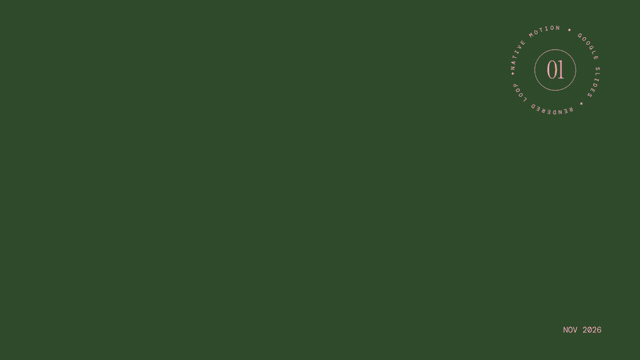
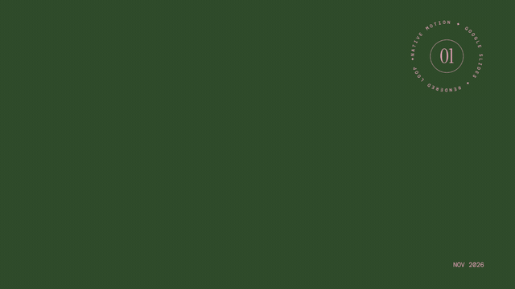
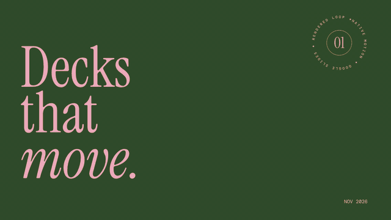
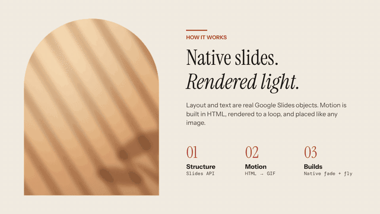
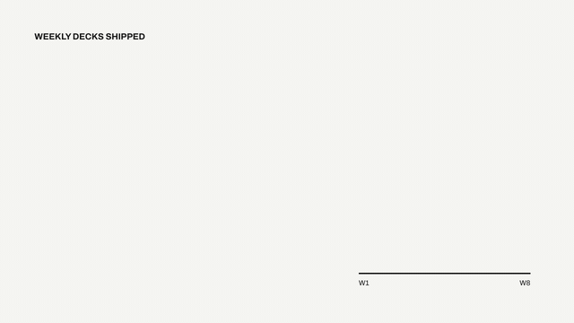
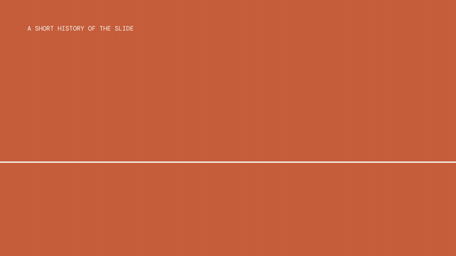
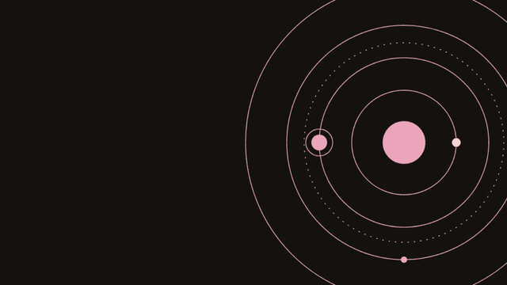

# Motion gallery

Six prompts. Eight native Google Slides. Real motion.



Every slide is built from native Google Slides objects: text in Google Fonts, shapes, builds and transitions.
Motion that Slides cannot do natively is a small looping GIF, rendered from HTML and placed like any image.
[`gallery.pptx`](gallery.pptx) (2.8 MB) converts to Google Slides with every build and transition intact.

## Examples

### Editorial title · Opener



> Title slide for a talk called "Decks that move." Editorial: one huge serif in soft pink on deep forest green. Stack the three words and bring them in one at a time. Put a small badge with rotating text in the corner. The only other text is the date.

**Type** Instrument Serif, DM Mono · **Palette** `#2F4B2B` `#EBA6BD`<br>
**Motion** Fade, fade, fly-in builds. Rotating badge loop (GIF, 0.6 MB).

### Photo-led content · Explainer



> Explain how it works in one slide. Warm, photo-led editorial. On the left, an arched window with slow light moving through blinds. Serif headline with one italic line, one short sentence, then three numbered steps that rise in one by one.

**Type** Instrument Serif, Instrument Sans, DM Mono · **Palette** `#F1EBE1` `#B5462B` `#1E1A16`<br>
**Motion** Fade transition. Fade and fly-in builds. Window-light loop (GIF, 1.1 MB).

### Kinetic poster · Hype opener



> Opener with poster energy. Rotated color blocks in yellow, hot pink, cobalt and black. Heavy condensed caps. Everything slams in fast, one piece at a time. The star spins last.

**Type** Anton, Instrument Sans · **Palette** `#FFD23F` `#FF3D7F` `#2B3BFF` `#141414`<br>
**Motion** Push transition. 9 chained builds: fly, zoom, spin. All native shapes and text.

### Big number · Data



> One data slide. Weekly decks shipped: 12, 14, 15, 19, 22, 27, 31, 38. Swiss style: off-white, black, one signal red for the last week. Bars rise one by one, then the multiple lands. Native and editable. No chart image.

**Type** Archivo Black, Archivo · **Palette** `#F5F5F2` `#141414` `#E63312`<br>
**Motion** Fade transition. 8 bars rise from the baseline, one by one. Number zooms in. No GIF: 100% native.

### Panorama timeline · Story



> Three-stop timeline: 1987, PowerPoint 1.0. 2007, presentations in Google Docs. 2026, slides that move. One line runs across all three slides, so each push transition reads as a camera pan. Clay and bone. A soft serif for the years. End on a pulsing dot.

**Type** Fraunces, DM Mono · **Palette** `#C65D3B` `#F6EEE3`<br>
**Motion** Push transitions as a pan. Dot zoom, year fly-in, caption fade. Ripple loop (GIF, 0.1 MB).

### Orbit hero · Closer



> Closing slide. A full-bleed orbit system turns slowly on warm black: pink rings, pink and cream planets, offset to the right. Two native lines over it: "Rendered once." and, in pink italic, "Plays forever."

**Type** Instrument Serif, DM Mono · **Palette** `#141210` `#EBA6BD` `#F1EBE1`<br>
**Motion** Fade transition. Full-bleed orbit loop (GIF, 0.9 MB). Native text fades in on top.

## Bring your own style

Fill in the brackets. Keep one idea per slide.

```text
Make a [N]-slide Google Slides deck about [topic].
Style: [2-4 colors]. [display font] for headlines, [text font] for body. Google Fonts only.
Motion: [calm | medium | punchy]. Builds one at a time: [fade | fly-in | zoom].
One rendered loop: [what moves, where, on the slide's exact background color].
Minimal text. No chrome: no page numbers, no corner labels.
```

Or point at a reference:

```text
Match the look of [video, poster, site or deck link].
Take the palette, type, layout and motion tempo. Not the brand, logos or footage.
```

## Tricks worth stealing

- **Pan across slides.** One line sits at the same height on three slides. The push transition reads as a camera pan.
- **Bars that grow.** Bars fly in from below, under a mask in the ground color at the baseline. They rise from the axis.
- **Loops with no edges.** Each GIF is rendered on the slide's exact background color, so it has no visible box.
- **Text over motion.** Headlines stay native text on top of a full-bleed loop. They stay editable.
- **Emphasis last.** The star is already on the slide. It spins after everything else lands.

## What is native, what is rendered

| Native Google Slides | Rendered |
|---|---|
| Text in Google Fonts, shapes, rotation | GIF loops: badge, window light, ripple, orbits |
| Builds: fade, fly-in, zoom, spin. Chained "after previous" | Outline text (PNG). Slides has no text stroke |
| Transitions: fade, push | |

Loop budget:

| Loop | Size | fps | Frames | File |
|---|---|---|---|---|
| `badge.gif` | 300×300 | 12 | 144 | 0.62 MB |
| `light.gif` | 288×368 | 5 | 50 | 1.13 MB |
| `orbits-night.gif` | 960×540 | 12 | 144 | 0.92 MB |
| `ripple.gif` | 200×200 | 15 | 36 | 0.14 MB |

## Rebuild

Needs Python with `python-pptx`, Node with Playwright (Chromium), and `ffmpeg`.

```bash
cd gallery/build
node render_loop.js loops/ripple.html ../assets/ripple.gif 200 12   # one loop: html -> GIF
python3 build_gallery.py      # ../gallery.pptx and out/scenes.js
python3 gifs_manifest.py      # GIF frames for the preview player
node render_preview.js        # ../previews/*.gif and *.mp4
python3 readme.py             # this file
```

Upload `gallery.pptx` to Google Drive and open it with Google Slides.

Previews come from [`build/player.html`](build/player.html). It replays the deck's builds, transitions and loops with the same timing that Slides uses.
Text placement was checked against a Google Slides PDF export of this deck (within about 0.05 in).
