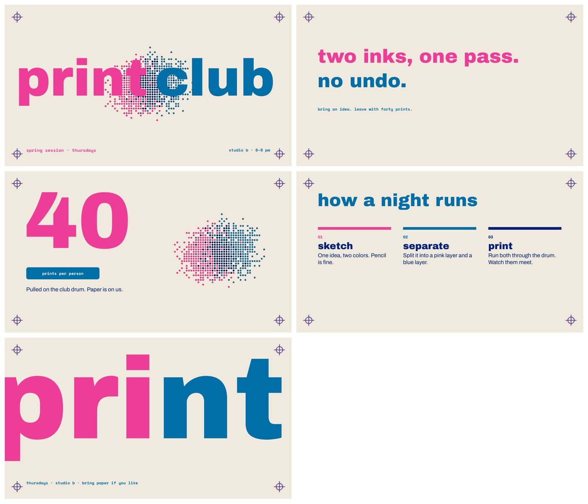
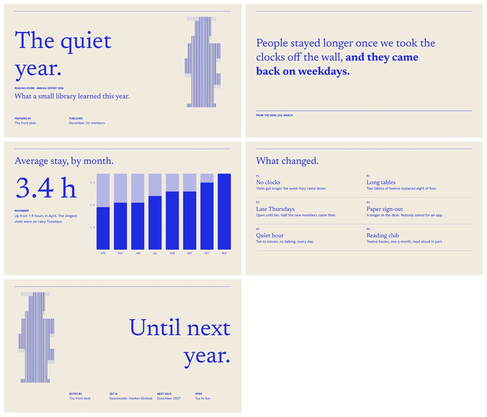

# Make a style from a reference

Input: a video, a deck (.pptx, .pdf, Google Slides link), a website or HTML file, or images.
Output: `styles/<slug>/style.md` in [`slide-style/v1`](SPEC.md), plus a 4-slide specimen that proves it.

Take the look. Never the content. No logos, product names, characters, copy, photos or footage from the reference go into the style or the deck.

## 1. Get the reference

| Reference | Do |
|---|---|
| Local file or direct media URL | Use it as is. |
| Website | Use the URL. |
| Google Slides link | Export it as .pptx through Drive (`files.export`, PowerPoint MIME type). Treat it as pptx. |
| YouTube, Vimeo, social | Ask the user for the file, or for 8-12 screenshots. |
| No shell available | Ask for 8-12 screenshots or frames. Skip step 2. Measure colors by eye and say so in `probe.md`. |

## 2. Probe

```
python3 scripts/probe_reference.py <file-or-url> work/<slug>-probe
```

Then read `probe.json` and look at `sheet.jpg` and `palette.png`. What each kind gives you:

| Kind | Measured |
|---|---|
| video, gif | Palette with role guesses. Cuts, shot lengths. Move and hold durations (`move_ms`, `hold_ms`). Share of time in motion. 16 frames, one per cut first. |
| pptx | Exact fonts, sizes, text and fill colors, backgrounds. Every build (effect, trigger, ms) and transition. Page renders. |
| pdf | Embedded font names. Page renders. Palette. |
| web, html | Computed font families, weights, case, tracking and their visual share. Text and background colors. CSS variables. CSS and live animation timings. One screenshot per slide or screen. |
| image | Palette. |

## 3. Read it like a designer

Write one line for each. Use the probe numbers. Mark guesses as guesses.

1. **Signature.** Which 2-3 moves would a person recognize from a thumbnail?
2. **Type.** Classify each role: "heavy grotesque, lowercase, tight", "book serif, sentence case". Note the scale jump from the largest to the smallest text.
3. **Color.** How many inks. Rough area split (for example 85% paper, 10% ink, 5% accent). Overprint, tint or gradient?
4. **Layout.** Alignment, margins, where the empty space sits, words per screen.
5. **Ornament.** Rules, marks, grids, textures, frames, stickers.
6. **Motion.** What moves (type, shapes, camera). How things enter (wipe, slide, scale, cut). Tempo. What loops.
7. **Context to drop.** Things that belong to the medium, not the style: a wall around a poster, cursors, browser chrome, page counters.

## 4. Translate to native Google Slides

**Fonts.** Keep a family if it is on Google Fonts. Otherwise map it:

| Reference font | Google Fonts |
|---|---|
| Helvetica, Neue Haas, Arial, Graphik, GT America | Inter, Hanken Grotesk, Schibsted Grotesk |
| SF Pro, Söhne, Neue Montreal | Inter, Inter Tight |
| Futura, Avenir, Proxima Nova, Gotham | Jost, Figtree, Montserrat |
| Garamond | EB Garamond, Cormorant Garamond |
| Times, Tiempos, Charter | Newsreader, Source Serif 4, Libre Caslon Text |
| Didot, Bodoni | Bodoni Moda, Playfair Display |
| Canela, GT Sectra, Editorial New | Fraunces, Instrument Serif |
| Druk, Knockout, Impact, Compacta | Anton, Bebas Neue, Big Shoulders Display, Oswald |
| Heavy wide grotesque (Druk Wide, Monument) | Archivo Black, Dela Gothic One |
| Courier, SF Mono, Menlo, Söhne Mono | DM Mono, JetBrains Mono, IBM Plex Mono, Space Mono |
| Brush or marker | Caveat, Permanent Marker |

For weights 800-900, pick a single-weight heavy family. PPTX import carries bold on or off only.

**Color.** Copy measured hex values. Change one only to pass contrast: `ink` 4.5:1 on `bg`, display colors 3:1. Say what you changed.

**Motion.** Map tempo to native builds:

| Probe | Spec value |
|---|---|
| `moving_share` < 0.25 / 0.25-0.5 / > 0.5 | `energy` calm / medium / high |
| `move_ms.median` | `builds.duration_ms`, clamped to 300-900 |
| Many short holds (`hold_ms.median` < 500) | `trigger: after`, short chains. Few long holds: fewer builds |
| Hard cuts | `transition: none`, or `fade` fast |
| Camera pans or slides | `transition: push` |
| Wipes | `fly` from the wipe's side. Wipe imports as fade anyway |
| Scale-ins, push-ins | `zoom` build |
| Continuous texture, particles, camera moves on a still | A loop. Flat colors, 4-8 of them, so the GIF stays small |

**Effects.** Gradient: keep it native (survives import). Texture, blur, glow, halftone: a PNG still or a loop. Letter spacing: choose a font that already has it.

## 5. Write `style.md`

Follow [SPEC.md](SPEC.md). Name it by the look ("riso-overprint"), never by the source. End the body with the `## Deck theme` JSON block, all nine type presets defined. Put the measured numbers and their source in `probe.md` next to it.

If a loop is part of the signature, write `loops/<name>.html` as a HyperFrames template with color variables named after palette roles (see `motion/*.html`). Render it with `scripts/render_loop.py loops/<name>.html assets/<name>.gif --theme deck.json`. Keep it flat: 4-8 colors, stepped motion where the reference allows, so the GIF stays under 0.5 MB.

## 6. Prove it with a specimen

Write `specimen.json` (4-5 slides in [deck-spec](../reference/deck-spec.md) format): title, statement or big number, content (list-3 or split), closing. Use the style's own recipes and loop. Build it with `scripts/build_deck.py specimen.json specimen.pptx --preview preview/`. For a quick check against the shared recipes, run `scripts/style_tour.py <slug> work/tour`. Put the specimen contact sheet next to the reference `sheet.jpg` and compare:

- Would someone who saw the reference recognize the style from a thumbnail?
- Is the biggest mismatch type, color, density or motion? Fix that one. Re-render. Stop after two passes.

## 7. Slop check

Fail any of these and fix it before you hand it over:

- Text on every slide is centered by default.
- Every slide is "headline left, card right".
- Page counters, corner labels or progress bars were copied from the reference.
- Glow, lens flare, purple-to-blue gradient, glassmorphism.
- Everything fades. Use the reference's entry directions instead.
- More than about 15 words on a title or statement slide.
- A font that is not on Google Fonts.
- Content, logos or footage from the reference.

## Worked examples

| Reference | Kind | Style | What carried over |
|---|---|---|---|
| onetake "overlap" film (15 s, one camera move) | video | [riso-overprint](riso-overprint/style.md) | Two measured inks and their overprint. Heavy lowercase type. Words meet from opposite sides. ~300 ms moves → 400 ms builds, push transitions |
| "Cobalt Grid" HTML deck | deck / site | [cobalt-ledger](cobalt-ledger/style.md) | CSS palette and fonts exactly. One-ink rule. Stair-stepped bar ornament. 280 ms CSS fades → 300 ms fade builds |
| This project's sample .pptx | pptx | round trip | Every font, color, build effect, build duration and transition came back exactly |

Each style folder has a `probe.md` with the measured numbers and what was dropped, a `specimen.json` deck, and `preview.jpg`.




